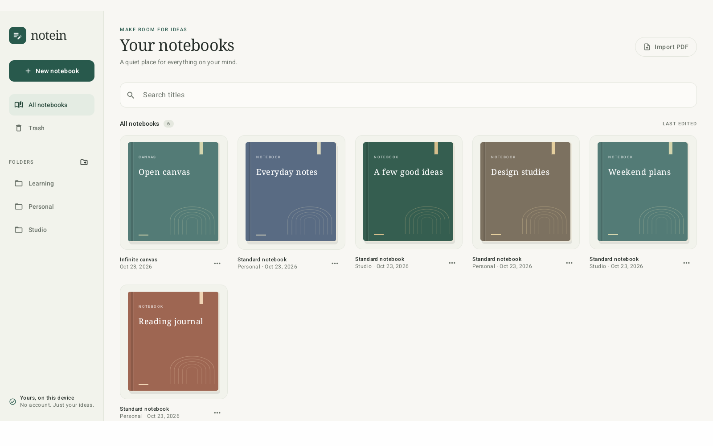
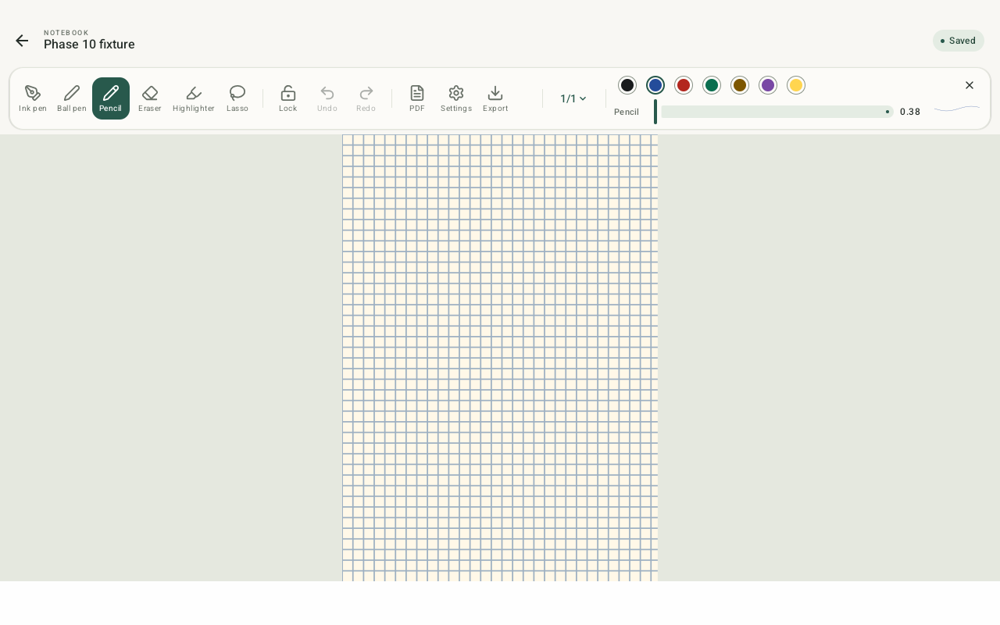
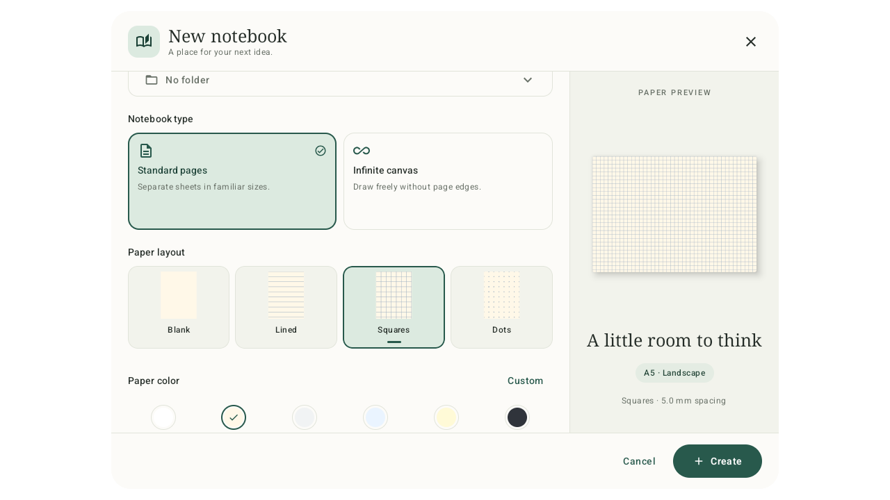

# Notein

A local-first Android notebook app built with Kotlin, Jetpack Compose, AndroidX Ink, and Room. Write with a stylus, add text and images, annotate PDFs, and export your work. Notes stay on the device; no account or cloud service is required.

## Features

- Responsive notebook-cover library with folders, search, rename, move, trash, and restore.
- Standard notebooks and infinite canvases, with a visual notebook and paper picker.
- Ink pen, ball pen, pencil, highlighter, and whole-stroke eraser.
- Ink colours, live stroke previews, and independent fractional thickness preferences.
- Stylus input, optional finger writing, pan, pinch zoom, and persistent zoom lock.
- Lasso selection, copy, cut, paste, move, resize, delete, and undo/redo for mixed content.
- Editable text boxes and photo or image-file imports.
- Insertable shapes, maths coordinate graphs, H1-H6 headings, and editable tables.
- Blank, lined, grid, and dotted paper with page-specific and notebook defaults.
- Page creation, duplication, deletion, previews, and horizontal or vertical navigation.
- Local PDF import, annotations, page/notebook export, and infinite-canvas region export.
- Autosave, failed-save retry, and Room migrations that preserve existing notes.
- Ivory and forest-green light theme, deep-green dark theme, and a tablet folder sidebar.

## Screenshots

### Notebook library



### Editor toolbar



### Notebook and paper picker



Screenshots use temporary test notebooks. More tablet, phone, and dark-mode captures are linked in the [verification reports](#verification).

## Create a notebook

Choose **Standard pages** or **Infinite canvas** using visual cards. Paper-style tiles show Blank, Lined, Squares, and Dots before you select them. A live preview sits beside the form on tablets and appears as a compact summary on phones. Create and Cancel stay visible while the settings scroll.

Choose a folder, one of six paper colours or a custom hexadecimal colour, and, for standard notebooks, A4, A5, or Letter paper in portrait or landscape. **More paper options** contains spacing presets, numeric spacing, and line or dot weight. Standard notebooks can automatically add the next matching page. Switching notebook types retains your choices; cancelling creates nothing.

## Editor toolbar

The tool order is:

**Ink pen > Ball pen > Pencil > Eraser > Highlighter > Lasso > Lock > Undo > Redo > PDF > Settings > Export**

Tap a pen, pencil, or highlighter to show its colours, thickness slider, and stroke sample on the toolbar's right side. The close button hides these controls. Selecting Lasso replaces them with selection actions. Tool changes keep the writing surface at the same height.

A compact **1/x** counter opens the page picker. Settings contains page layout (Side by side or One below another), fit, add/duplicate/delete page, text and image insertion, paper options, and finger writing. Actions that do not apply to the current page are disabled. On narrower tablets the tool list scrolls; on phones the whole toolbar can be swiped horizontally.

**One below another** scrolls as a continuous strip: parts of the preceding and following pages stay visible across the page gaps. Releasing the scroll keeps the paper in place and selects the most visible page for editing. Mixed paper sizes share the same zoom, and a single drag can cross several pages.

Finger scrolling and pinching do not show **Finishing ink**. Completed viewport changes use normal autosave and may briefly show **Saving** before returning to **Saved**.

When zoomed paper is wider than the screen, drag left or right to pan across it in either page layout. **Lock zoom** keeps the magnification fixed while allowing panning in both directions. The horizontal position is saved with the page and retained through vertical page transitions. Paper stays centred when the page strip fits the screen. In **Side by side**, pan to a paper edge, then start a new outward drag to turn the page.

Copy retains the existing immediate-duplicate behaviour and also makes the selection available to Paste. Cut and Paste work within the open notebook, including across its pages, and participate in Undo/Redo. The selection clipboard lasts for the current notebook session.

## Insert shapes, graphs, headings, and tables

Open **Settings > Insert** to choose:

- **Shape:** square, rectangle, triangle, right triangle, circle, ellipse, diamond, line, or arrow. Adjust dimensions, colour, outline width, and fill.
- **Graph:** maths coordinate axes with X/Y ranges, fractional grid steps, optional grid and number labels, and adjustable size. Write on the graph using any pen tool.
- **Heading:** choose H1-H6, then enter the title. Its heading level is saved and registered in the current page's heading outline inside Insert. Tap an outline entry to centre and select it.
- **Table:** type the initial number of rows (1–50) and columns (1–30), then edit cells, style the first row as a header, add or delete rows/columns, set individual row heights and column widths, resize the whole table, or delete it.

New objects are selected automatically. Move or resize them with Lasso, then use **Edit shape**, **Edit graph**, **Edit heading**, or **Edit table** to change their settings. Double-tapping an object in Lasso mode also opens its editor. Table changes remain a draft until Save; Cancel preserves the original. All four support saving/reopening, copy/cut/paste, undo/redo, page previews, and PDF export.

## Requirements

| Component | Project configuration |
| --- | --- |
| Android device | Android 8.0 / API 26 or newer |
| JDK | 25; Java and Kotlin emit Java 17 bytecode |
| Android SDK | Platform 36 and Build Tools 36.0.0 |
| Gradle | 9.3.1, supplied through the wrapper |
| Android Gradle Plugin | 9.1.1 |
| Kotlin / Compose plugin | 2.2.20 |

Versions are pinned in [gradle/libs.versions.toml](gradle/libs.versions.toml). Python is optional for regenerating icons and running PDF verification helpers.

## Build

Open the project in Android Studio, select JDK 25 for Gradle, and install the required Android SDK components. Set the SDK path in `local.properties`, which is excluded from Git:

```properties
sdk.dir=C:/path/to/Android/Sdk
```

Set `JAVA_HOME` to your JDK 25 installation, then run:

```powershell
./gradlew.bat assembleDebug
```

On macOS or Linux, use `./gradlew assembleDebug`. The first build needs internet access to download Gradle and dependencies. Use `--offline` after they are cached.

The debug APK is generated at `app/build/outputs/apk/debug/app-debug.apk`. APKs and other build outputs are excluded from the repository.

## Install or update

Enable USB debugging, connect the device, and use the Android SDK's `adb` command. Replace `DEVICE_SERIAL` with a serial shown by `adb devices`:

```powershell
adb devices
adb -s DEVICE_SERIAL install -r app/build/outputs/apk/debug/app-debug.apk
adb -s DEVICE_SERIAL shell am start -n com.ramst.notein/.MainActivity
```

The `-r` option updates an existing installation while preserving its data when the package and signing key match. The application ID is `com.ramst.notein`.

## Verification

Build the app and instrumentation APKs, then run Android lint:

```powershell
./gradlew.bat assembleDebug assembleDebugAndroidTest lintDebug
```

The Windows emulator runners expect SDK tools at `.tools/android-sdk`. Adjust their `adb` path if your SDK is elsewhere:

```powershell
./scripts/test-ui-redesign.ps1 -Serial emulator-5554
./scripts/test-inline-toolbar.ps1 -Serial emulator-5554
./scripts/test-notebook-picker.ps1 -Serial emulator-5554
./scripts/test-insert.ps1 -Serial emulator-5554
./scripts/test-continuous-pages.ps1 -Serial emulator-5554
./scripts/test-scroll-status.ps1 -Serial emulator-5554
./scripts/test-horizontal-pan.ps1 -Serial emulator-5554
./scripts/test-phase10.ps1 -Serial emulator-5554
```

The UI runners check tablet and phone layouts, restore display and night-mode settings, and save screenshots and logs under `reports/`. They use `adb install -r` and clean up their own fixtures instead of clearing application data. The phase 10 runner also checks ink, PDF, migrations, rendering, and persistence. Some earlier phase UI runners reflect older layouts.

Recorded verification runs:

| Date | Scope | Passing checks | Report |
| --- | --- | --- | --- |
| 23 October 2026 | Library and theme redesign; tablet, phone light/dark | 32 | [UI redesign](reports/ui-redesign/VERIFICATION.md) |
| 23 October 2026 | Inline tool controls, page picker, selection actions, handwriting | 45 | [Editor toolbar](reports/inline-toolbar/VERIFICATION.md) |
| 24 October 2026 | Notebook picker; saved settings, scrolling, cancellation, library workflows | 19 | [Notebook picker](reports/notebook-picker/VERIFICATION.md) |
| 25 October 2026 | Shapes, maths graphs, headings, tables; save/export and editor regressions | 30 + 4 final dark-mode checks | [Insert tools](reports/insert/VERIFICATION.md) |
| 25 October 2026 | Continuous vertical pages, typed table counts, writing and save regressions | 31 | [Continuous pages and table counts](reports/continuous-pages/VERIFICATION.md) |
| 25 October 2026 | Correct save status during scrolling/pinching; gesture, toolbar, storage and handwriting regressions | 34 | [Scroll save status](reports/scroll-status/VERIFICATION.md) |
| 25 October 2026 | Horizontal panning with zoom locked/unlocked, both page layouts, saved offsets and page transitions | 49 | [Horizontal panning](reports/horizontal-pan/VERIFICATION.md) |

These runs passed build and lint with zero lint errors; existing warnings remain. Handwriting handoff, rapid dots/crossbars, and stale-storage regressions are documented in the [handwriting verification report](reports/handwriting/VERIFICATION.md). Emulator checks use synthetic input; physical stylus latency and palm rejection require device testing.

PDF verification uses `scripts/verify-phase6-pdfs.py` with `pypdf`, `pypdfium2`, and Pillow installed.

## Project layout

```text
app/
  src/main/java/com/ramst/notein/
    library/         Notebook library and creation picker
    editor/          Drawing canvas, tools, paper and selection controls
    storage/         Room entities, DAOs and repositories
    pdf/             PDF import, rendering and export
    ui/              App UI and theme
  src/main/res/      Android resources and vector icons
  src/androidTest/   Instrumentation tests
  schemas/           Room migration schemas
assets/icons/editor/ SVG originals, attribution and conversion notes
docs/screenshots/    Reviewed screenshots used by the documentation
gradle/              Wrapper and dependency version catalog
scripts/             Build verification and asset helpers
reports/             Implementation and verification notes
```

## Icons and repository hygiene

Toolbar SVGs come from [Lucide](https://github.com/lucide-icons/lucide). The ISC and applicable Feather MIT notices are included in [assets/icons/editor/LICENSE](assets/icons/editor/LICENSE) and packaged in the app's assets. Regenerate the Android VectorDrawables with:

```powershell
python scripts/convert-editor-icons.py
```

The [.gitignore](.gitignore) excludes SDKs, build outputs, APKs, machine settings, signing keys, local notebook databases, device dumps/backups, scratch files, and generated verification evidence. Selected screenshots are copied into `docs/screenshots/` for version control; test runners continue writing disposable captures under `reports/`. Source assets, Room schema JSON, the Gradle wrapper, and Markdown reports remain tracked or eligible for Git.

Implementation history is recorded in [NOTEIN_IMPLEMENTATION_PLAN.md](NOTEIN_IMPLEMENTATION_PLAN.md) and the Markdown reports under `reports/`.
